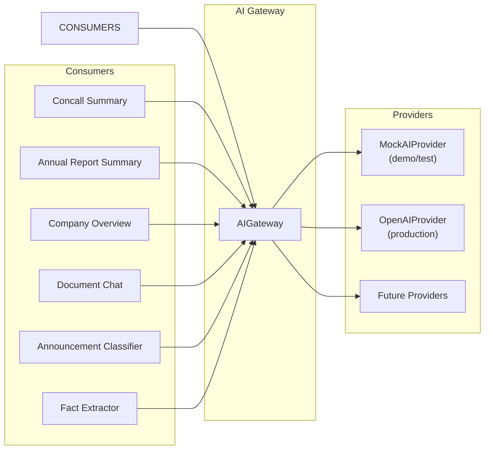
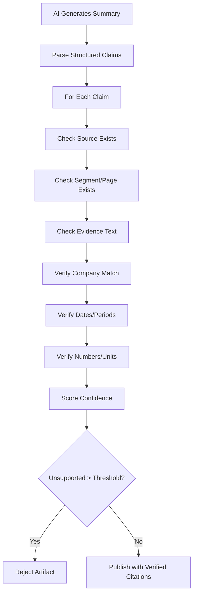

# ResearchOS — AI Architecture

## Provider Abstraction



## Provider Interface

```python
class AIProvider(ABC):
    async def classify_announcement(text, categories) -> ClassificationResult
    async def generate_concall_summary(transcript, template) -> SummaryResult
    async def generate_annual_report_summary(sections, template) -> SummaryResult
    async def generate_company_overview(context, template) -> OverviewResult
    async def answer_document_question(question, context, history) -> AnswerResult
    async def extract_structured_facts(text, schema) -> ExtractionResult
    async def create_embeddings(texts) -> list[list[float]]
    async def transcribe_audio(audio_url) -> TranscriptionResult
```

## Prompt Versioning

Prompts are versioned and stored in `apps/api/src/modules/ai_research/prompts/`:

```
prompts/
  concall_summary/
    v1.md
    v2.md
  annual_report_summary/
    v1.md
  company_overview/
    v1.md
  document_chat/
    v1.md
  announcement_classifier/
    v1.md
```

Each AI artifact records:
- `prompt_version`: Which prompt was used
- `model_name`: Which model generated the output
- `input_tokens` / `output_tokens`: Token usage
- `generation_timestamp`: When generated
- `source_document_versions`: Input document version IDs

## Citation Verification Pipeline



## Claim Structure

```json
{
  "claim_id": "uuid",
  "claim_text": "Revenue grew 18% YoY to ₹15,200 crore",
  "claim_type": "reported_metric",
  "citations": [
    {
      "source_type": "transcript_segment",
      "source_id": "segment-uuid",
      "source_text": "Our revenue for the quarter stood at fifteen thousand two hundred crores...",
      "page_or_sequence": 12,
      "confidence": 0.94
    }
  ],
  "verification_status": "verified",
  "confidence": 0.94
}
```

## Mock Provider

The `MockAIProvider` returns deterministic responses:
- Pre-built summary templates with placeholder values filled from actual data
- Deterministic embeddings (hash-based vectors)
- Fixed classification results
- All citations point to real synthetic transcript segments
- Zero external API calls required

## Model Selection by Task

| Task | Default Model | Fallback |
|------|--------------|----------|
| Concall summary | gpt-4o | gpt-4o-mini |
| Annual report summary | gpt-4o | gpt-4o-mini |
| Company overview | gpt-4o | gpt-4o-mini |
| Document chat | gpt-4o-mini | — |
| Announcement classification | gpt-4o-mini | — |
| Fact extraction | gpt-4o | gpt-4o-mini |
| Embeddings | text-embedding-3-small | — |
| Transcription | whisper-1 | — |

## Token & Cost Tracking

Every AI operation records:
- `input_tokens`, `output_tokens`
- `estimated_cost_usd` (based on model pricing config)
- `latency_ms`
- `provider`, `model`
- Aggregated in `UsageLedger` for subscription enforcement

## Security

- Document content is untrusted input
- Retrieved instructions cannot override system prompts
- Company-scoped retrieval enforced before AI context
- Tenant authorization checked before document access
- AI outputs clearly marked as "AI interpretation"
