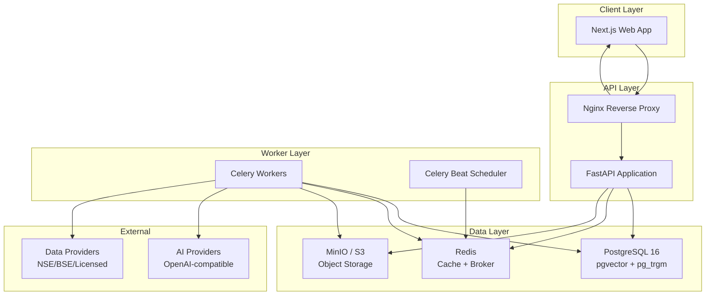
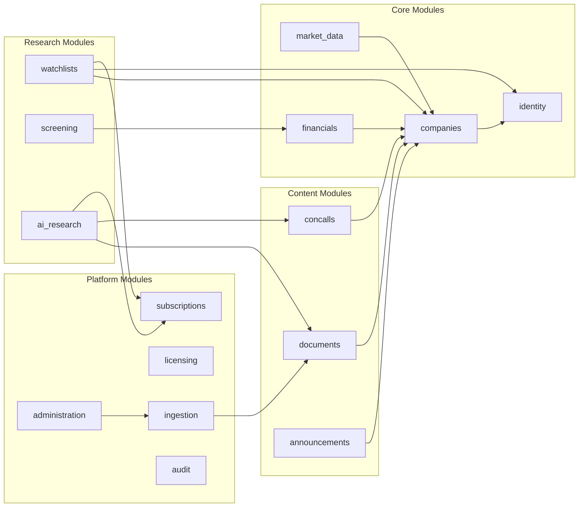
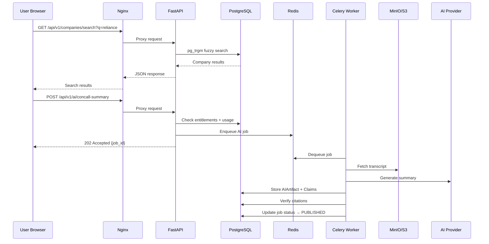
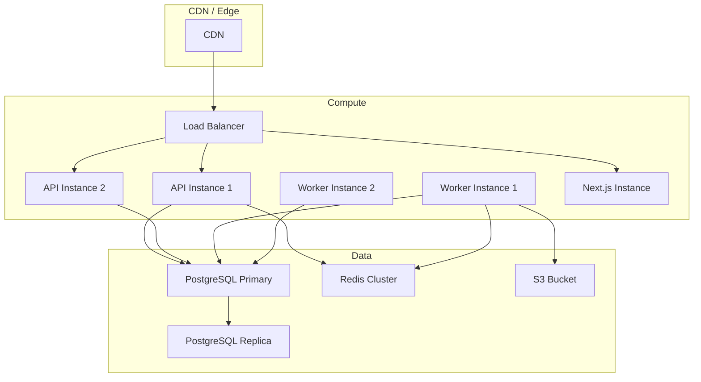

# ResearchOS — High-Level Design

## 1. Architecture Overview

ResearchOS is a **modular monolith** with asynchronous workers, designed for eventual service extraction.

## 2. Module Architecture

### Module Responsibilities

| Module | Owns | Key Operations |
|--------|------|----------------|
| `identity` | Users, Orgs, Roles, Sessions | Auth, RBAC |
| `companies` | Company, Security, Exchange, Identifiers | Search, company profiles |
| `market_data` | Prices, Corporate Actions | EOD price ingestion |
| `financials` | Periods, Statements, Facts, Metrics | Versioned financial data |
| `documents` | Documents, Versions, Sections, Filings | Document lifecycle |
| `concalls` | Events, Transcripts, Segments | Concall tracking |
| `announcements` | Announcements, Categories, Ideas | Feed and classification |
| `watchlists` | Watchlists, WatchlistCompanies | User watchlist management |
| `screening` | Filters, Executions | Financial screening |
| `ai_research` | AIArtifacts, Claims, Citations, Chat | AI generation and verification |
| `subscriptions` | Plans, Subscriptions, Entitlements, Usage | Billing and limits |
| `licensing` | DataLicences | Rights enforcement |
| `ingestion` | IngestionJobs | Pipeline orchestration |
| `administration` | — | Admin operations |
| `audit` | AuditEvents | Compliance logging |

## 3. Request Flow

## 4. Data Flow

```mermaid
graph TD
    subgraph "Ingestion"
        DISC["Discover"] --> DL["Download"]
        DL --> VAL["Validate + Checksum"]
        VAL --> DEDUP["Deduplicate"]
        DEDUP --> STORE["Store Original → S3"]
        STORE --> PARSE["Parse Text + Tables"]
        PARSE --> OCR{"OCR Needed?"}
        OCR -->|Yes| OCRP["OCR Processing"]
        OCR -->|No| NORM["Normalize Metadata"]
        OCRP --> NORM
        NORM --> SPLIT["Split Sections"]
        SPLIT --> EXTRACT["Extract Facts"]
        EXTRACT --> INDEX["Search Index"]
        INDEX --> EMBED["Create Embeddings"]
        EMBED --> AIGEN["AI Generation"]
        AIGEN --> CITE["Verify Citations"]
        CITE --> PUB["Publish"]
    end
```

## 5. Deployment Topology (Production)

## 6. Security Architecture

- Passwords: bcrypt hashing
- Sessions: JWT + HTTP-only cookies
- Authorization: Server-side RBAC on every request
- Tenant isolation: `user_id` / `organization_id` on private records
- API: Rate limiting, request IDs, parameterized SQL only
- Files: Upload validation, size limits, signed URLs
- Webhooks: Signature verification
- Logging: No PII, passwords, tokens, or payment data

## 7. Technology Stack Summary

| Layer | Technology |
|-------|-----------|
| Frontend | Next.js 14, TypeScript, Tailwind CSS, Radix UI |
| Data Fetching | TanStack Query, OpenAPI-generated client |
| Forms | React Hook Form + Zod |
| Backend | FastAPI, Python 3.12, Pydantic v2 |
| ORM | SQLAlchemy 2.0 (async) |
| Database | PostgreSQL 16 + pgvector + pg_trgm |
| Migrations | Alembic |
| Cache/Broker | Redis 7 |
| Workers | Celery 5 |
| Object Storage | MinIO (dev) / S3 (prod) |
| Testing | Pytest, Vitest, Playwright |
| Infrastructure | Docker Compose (dev), IaC stubs (prod) |
