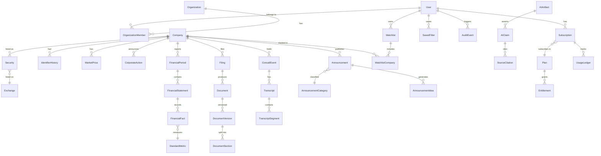

# ResearchOS — Low-Level Design

## 1. Entity-Relationship Diagram



## 2. Core Tables

### identity module

```sql
-- users
id UUID PK
email VARCHAR(255) UNIQUE NOT NULL
password_hash VARCHAR(255) NOT NULL
display_name VARCHAR(100)
role VARCHAR(20) DEFAULT 'user'  -- user, analyst, admin
is_active BOOLEAN DEFAULT true
email_verified BOOLEAN DEFAULT false
created_at TIMESTAMPTZ
updated_at TIMESTAMPTZ

-- organizations
id UUID PK
name VARCHAR(200) NOT NULL
slug VARCHAR(100) UNIQUE
created_at TIMESTAMPTZ

-- organization_members
id UUID PK
organization_id UUID FK -> organizations
user_id UUID FK -> users
role VARCHAR(20) DEFAULT 'member'
joined_at TIMESTAMPTZ

-- sessions
id UUID PK
user_id UUID FK -> users
token_hash VARCHAR(255)
expires_at TIMESTAMPTZ
created_at TIMESTAMPTZ
```

### companies module

```sql
-- exchanges
id UUID PK
code VARCHAR(10) UNIQUE  -- NSE, BSE
name VARCHAR(100)
country VARCHAR(2) DEFAULT 'IN'

-- companies
id UUID PK
name VARCHAR(300) NOT NULL
slug VARCHAR(300) UNIQUE
isin VARCHAR(12)
sector VARCHAR(100)
industry VARCHAR(100)
description TEXT
founded_year INTEGER
headquarters VARCHAR(200)
website VARCHAR(500)
is_active BOOLEAN DEFAULT true
created_at TIMESTAMPTZ
updated_at TIMESTAMPTZ
-- GIN index on name for pg_trgm

-- securities
id UUID PK
company_id UUID FK -> companies
exchange_id UUID FK -> exchanges
symbol VARCHAR(20) NOT NULL
is_primary BOOLEAN DEFAULT false
listing_date DATE
delisting_date DATE
UNIQUE (exchange_id, symbol)

-- identifier_history
id UUID PK
company_id UUID FK -> companies
identifier_type VARCHAR(20) -- name, symbol, isin
old_value VARCHAR(300)
new_value VARCHAR(300)
effective_date DATE
source VARCHAR(100)
created_at TIMESTAMPTZ
```

### market_data module

```sql
-- market_prices
id UUID PK
security_id UUID FK -> securities
date DATE NOT NULL
open DECIMAL(18,4)
high DECIMAL(18,4)
low DECIMAL(18,4)
close DECIMAL(18,4)
volume BIGINT
market_cap DECIMAL(20,2)
source VARCHAR(100)
created_at TIMESTAMPTZ
UNIQUE (security_id, date)

-- corporate_actions
id UUID PK
company_id UUID FK -> companies
action_type VARCHAR(50) -- dividend, split, bonus, rights, buyback
ex_date DATE
record_date DATE
details JSONB
source VARCHAR(100)
created_at TIMESTAMPTZ
```

### financials module

```sql
-- standard_metrics
id UUID PK
code VARCHAR(50) UNIQUE -- revenue, pat, total_assets, etc.
name VARCHAR(200)
category VARCHAR(50) -- income, expense, asset, liability, equity, ratio, cashflow
unit_type VARCHAR(20) -- currency, percentage, ratio, number
statement_type VARCHAR(20) -- pnl, balance_sheet, cashflow, ratio
display_order INTEGER

-- financial_periods
id UUID PK
company_id UUID FK -> companies
period_type VARCHAR(10) -- quarterly, annual
period_start DATE
period_end DATE
fiscal_year INTEGER
fiscal_quarter INTEGER
standalone_or_consolidated VARCHAR(15) DEFAULT 'standalone'
UNIQUE (company_id, period_type, period_start, period_end, standalone_or_consolidated)

-- financial_statements
id UUID PK
financial_period_id UUID FK -> financial_periods
statement_type VARCHAR(20) -- pnl, balance_sheet, cashflow
source_document_version_id UUID FK -> document_versions
publication_timestamp TIMESTAMPTZ
created_at TIMESTAMPTZ

-- financial_facts
id UUID PK
company_id UUID FK -> companies
financial_statement_id UUID FK -> financial_statements
standard_metric_id UUID FK -> standard_metrics
original_label VARCHAR(500)
value DECIMAL(20,4)
unit VARCHAR(20)
currency VARCHAR(3) DEFAULT 'INR'
period_start DATE
period_end DATE
period_type VARCHAR(10)
standalone_or_consolidated VARCHAR(15)
publication_timestamp TIMESTAMPTZ
known_from TIMESTAMPTZ DEFAULT now()
known_until TIMESTAMPTZ  -- NULL = current
source_document_version_id UUID FK -> document_versions
source_page INTEGER
source_location VARCHAR(200)
extraction_confidence DECIMAL(5,4)
version_number INTEGER DEFAULT 1
supersedes_financial_fact_id UUID FK -> financial_facts
created_at TIMESTAMPTZ
```

### documents module

```sql
-- filings
id UUID PK
company_id UUID FK -> companies
filing_type VARCHAR(50) -- quarterly_result, annual_result, annual_report, investor_presentation
filing_date DATE
source_url VARCHAR(2000)
provider VARCHAR(100)
created_at TIMESTAMPTZ

-- documents
id UUID PK
filing_id UUID FK -> filings
company_id UUID FK -> companies
title VARCHAR(500)
document_type VARCHAR(50)
created_at TIMESTAMPTZ

-- document_versions
id UUID PK
document_id UUID FK -> documents
version_number INTEGER DEFAULT 1
supersedes_document_version_id UUID FK -> document_versions
source_url VARCHAR(2000)
provider VARCHAR(100)
publication_timestamp TIMESTAMPTZ
retrieval_timestamp TIMESTAMPTZ
financial_period_id UUID FK -> financial_periods
sha256_checksum VARCHAR(64)
mime_type VARCHAR(100)
storage_key VARCHAR(500) -- S3/MinIO key
file_size_bytes BIGINT
processing_status VARCHAR(30) DEFAULT 'DISCOVERED'
extraction_status VARCHAR(30)
licence_id UUID FK -> data_licences
page_count INTEGER
created_at TIMESTAMPTZ

-- document_sections
id UUID PK
document_version_id UUID FK -> document_versions
section_type VARCHAR(50)
title VARCHAR(500)
content TEXT
page_start INTEGER
page_end INTEGER
sequence INTEGER
embedding vector(1536)
created_at TIMESTAMPTZ
```

### concalls module

```sql
-- concall_events
id UUID PK
company_id UUID FK -> companies
title VARCHAR(500)
event_type VARCHAR(30) -- earnings_call, analyst_meet, agm
scheduled_at TIMESTAMPTZ
actual_start TIMESTAMPTZ
actual_end TIMESTAMPTZ
status VARCHAR(20) -- scheduled, completed, cancelled
financial_period_id UUID FK -> financial_periods
recording_url VARCHAR(2000)
presentation_document_id UUID FK -> documents
source VARCHAR(100)
created_at TIMESTAMPTZ
updated_at TIMESTAMPTZ

-- transcripts
id UUID PK
concall_event_id UUID FK -> concall_events
document_version_id UUID FK -> document_versions
source_type VARCHAR(30) -- official, ai_generated, user_uploaded
language VARCHAR(10) DEFAULT 'en'
is_verified BOOLEAN DEFAULT false
created_at TIMESTAMPTZ

-- transcript_segments
id UUID PK
transcript_id UUID FK -> transcripts
speaker_name VARCHAR(200)
speaker_role VARCHAR(200)
sequence INTEGER
timestamp_start INTERVAL
timestamp_end INTERVAL
segment_type VARCHAR(30) -- prepared_remarks, qa_question, qa_answer, operator
text TEXT
confidence DECIMAL(5,4)
source_reference VARCHAR(200)
embedding vector(1536)
created_at TIMESTAMPTZ
```

### announcements module

```sql
-- announcement_categories
id UUID PK
code VARCHAR(50) UNIQUE
name VARCHAR(200)
description TEXT

-- announcements
id UUID PK
company_id UUID FK -> companies
category_id UUID FK -> announcement_categories
title VARCHAR(1000)
content TEXT
summary TEXT
source_url VARCHAR(2000)
exchange VARCHAR(10)
published_at TIMESTAMPTZ
discovered_at TIMESTAMPTZ
is_material BOOLEAN DEFAULT false
materiality_reason TEXT
materiality_confidence DECIMAL(5,4)
provider VARCHAR(100)
created_at TIMESTAMPTZ

-- announcement_ideas
id UUID PK
announcement_id UUID FK -> announcements
idea_type VARCHAR(50) -- order_win, capex, acquisition, etc.
explanation TEXT
evidence TEXT
confidence DECIMAL(5,4)
analyst_correction VARCHAR(50)
corrected_by UUID FK -> users
corrected_at TIMESTAMPTZ
created_at TIMESTAMPTZ
```

### watchlists module

```sql
-- watchlists
id UUID PK
user_id UUID FK -> users
organization_id UUID FK -> organizations
name VARCHAR(200)
description TEXT
display_order INTEGER
is_deleted BOOLEAN DEFAULT false
created_at TIMESTAMPTZ
updated_at TIMESTAMPTZ

-- watchlist_companies
id UUID PK
watchlist_id UUID FK -> watchlists
company_id UUID FK -> companies
display_order INTEGER
notes TEXT
added_at TIMESTAMPTZ
```

### screening module

```sql
-- saved_filters
id UUID PK
user_id UUID FK -> users
name VARCHAR(200)
description TEXT
filter_expression JSONB NOT NULL
result_columns JSONB
sort_config JSONB
created_at TIMESTAMPTZ
updated_at TIMESTAMPTZ

-- filter_executions
id UUID PK
user_id UUID FK -> users
saved_filter_id UUID FK -> saved_filters
filter_expression JSONB NOT NULL
result_count INTEGER
execution_time_ms INTEGER
executed_at TIMESTAMPTZ
```

### ai_research module

```sql
-- ai_artifacts
id UUID PK
company_id UUID FK -> companies
artifact_type VARCHAR(50) -- concall_summary, ar_summary, company_overview
status VARCHAR(30) -- pending, processing, published, failed, rejected
generation_timestamp TIMESTAMPTZ
data_cutoff_date DATE
model_name VARCHAR(100)
prompt_version VARCHAR(20)
input_tokens INTEGER
output_tokens INTEGER
estimated_cost_usd DECIMAL(10,6)
latency_ms INTEGER
content JSONB
source_document_version_ids UUID[]
regeneration_of UUID FK -> ai_artifacts
unsupported_claim_count INTEGER
total_claim_count INTEGER
created_by UUID FK -> users
created_at TIMESTAMPTZ

-- ai_claims
id UUID PK
ai_artifact_id UUID FK -> ai_artifacts
claim_text TEXT
claim_type VARCHAR(50)
section VARCHAR(100)
confidence DECIMAL(5,4)
verification_status VARCHAR(20) -- verified, unsupported, partial
verified_at TIMESTAMPTZ
created_at TIMESTAMPTZ

-- source_citations
id UUID PK
ai_claim_id UUID FK -> ai_claims
source_type VARCHAR(50) -- transcript_segment, document_section, financial_fact, announcement
source_id UUID
source_text TEXT
page_or_sequence INTEGER
location VARCHAR(200)
confidence DECIMAL(5,4)
created_at TIMESTAMPTZ

-- chat_conversations
id UUID PK
user_id UUID FK -> users
company_id UUID FK -> companies
title VARCHAR(500)
document_scope UUID[]  -- document_version_ids
created_at TIMESTAMPTZ
updated_at TIMESTAMPTZ

-- chat_messages
id UUID PK
conversation_id UUID FK -> chat_conversations
role VARCHAR(10) -- user, assistant
content TEXT
citations JSONB
tokens_used INTEGER
created_at TIMESTAMPTZ
```

### subscriptions module

```sql
-- plans
id UUID PK
code VARCHAR(50) UNIQUE -- STARTER, PROFESSIONAL, etc.
name VARCHAR(100)
description TEXT
price_monthly DECIMAL(10,2)
price_annual DECIMAL(10,2)
currency VARCHAR(3) DEFAULT 'INR'
is_active BOOLEAN DEFAULT true
display_order INTEGER
created_at TIMESTAMPTZ

-- entitlements
id UUID PK
plan_id UUID FK -> plans
feature_key VARCHAR(100) -- watchlists.count, concall.summaries, etc.
limit_value INTEGER  -- NULL = unlimited
period VARCHAR(10) -- month, year, NULL for absolute
created_at TIMESTAMPTZ
UNIQUE (plan_id, feature_key)

-- subscriptions
id UUID PK
user_id UUID FK -> users
plan_id UUID FK -> plans
status VARCHAR(20) -- active, cancelled, payment_failed, expired
payment_provider VARCHAR(50)
external_subscription_id VARCHAR(200)
current_period_start DATE
current_period_end DATE
cancelled_at TIMESTAMPTZ
created_at TIMESTAMPTZ
updated_at TIMESTAMPTZ

-- usage_ledger
id UUID PK
user_id UUID FK -> users
subscription_id UUID FK -> subscriptions
feature_key VARCHAR(100)
delta INTEGER  -- +1 for use, -1 for refund
idempotency_key VARCHAR(200) UNIQUE
operation_type VARCHAR(20) -- use, refund, reset, override
reference_id UUID
reference_type VARCHAR(50)
period_start DATE
period_end DATE
created_at TIMESTAMPTZ
```

### licensing module

```sql
-- data_licences
id UUID PK
provider VARCHAR(100)
dataset VARCHAR(100)
licence_type VARCHAR(30)
internal_use_allowed BOOLEAN DEFAULT false
display_allowed BOOLEAN DEFAULT false
derived_data_allowed BOOLEAN DEFAULT false
redistribution_allowed BOOLEAN DEFAULT false
export_allowed BOOLEAN DEFAULT false
api_delivery_allowed BOOLEAN DEFAULT false
ai_processing_allowed BOOLEAN DEFAULT false
ai_training_allowed BOOLEAN DEFAULT false
document_retention_allowed BOOLEAN DEFAULT true
allowed_channels VARCHAR(100)[]
allowed_regions VARCHAR(10)[]
contract_start DATE
contract_expiry DATE
attribution_required BOOLEAN DEFAULT false
terms_url VARCHAR(2000)
notes TEXT
created_at TIMESTAMPTZ
updated_at TIMESTAMPTZ
```

### ingestion module

```sql
-- ingestion_jobs
id UUID PK
job_type VARCHAR(50)
company_id UUID FK -> companies
document_version_id UUID FK -> document_versions
status VARCHAR(30)
pipeline_stage VARCHAR(30)
priority INTEGER DEFAULT 0
attempts INTEGER DEFAULT 0
max_attempts INTEGER DEFAULT 3
unique_key VARCHAR(500) UNIQUE
input_params JSONB
result JSONB
error_message TEXT
started_at TIMESTAMPTZ
completed_at TIMESTAMPTZ
next_retry_at TIMESTAMPTZ
created_at TIMESTAMPTZ
updated_at TIMESTAMPTZ
```

### audit module

```sql
-- audit_events
id UUID PK
user_id UUID FK -> users
action VARCHAR(100)
resource_type VARCHAR(50)
resource_id UUID
details JSONB
ip_address VARCHAR(45)
user_agent VARCHAR(500)
request_id VARCHAR(100)
created_at TIMESTAMPTZ
```

## 3. API Endpoint Design

All endpoints prefixed with `/api/v1/`.

### Authentication
| Method | Path | Auth | Description |
|--------|------|------|-------------|
| POST | /auth/register | Public | Create account |
| POST | /auth/login | Public | Login |
| POST | /auth/logout | Auth | Logout |
| POST | /auth/password-reset | Public | Request reset |
| POST | /auth/demo-login | Public | Demo user login |
| GET | /auth/me | Auth | Current user |

### Companies
| Method | Path | Auth | Description |
|--------|------|------|-------------|
| GET | /companies/search | Public | Search companies |
| GET | /companies/{id} | Public | Company details |
| GET | /companies/{id}/financials | Public | Financial data |
| GET | /companies/{id}/documents | Public | Company documents |
| GET | /companies/{id}/concalls | Public | Concall events |
| GET | /companies/{id}/announcements | Public | Announcements |

### Watchlists
| Method | Path | Auth | Description |
|--------|------|------|-------------|
| GET | /watchlists | Auth | List watchlists |
| POST | /watchlists | Auth | Create watchlist |
| PATCH | /watchlists/{id} | Auth | Update watchlist |
| DELETE | /watchlists/{id} | Auth | Soft-delete |
| POST | /watchlists/{id}/companies | Auth | Add company |
| DELETE | /watchlists/{id}/companies/{cid} | Auth | Remove company |

### AI Research
| Method | Path | Auth | Description |
|--------|------|------|-------------|
| POST | /ai/concall-summary | Auth | Generate summary |
| POST | /ai/chat | Auth | Document chat (SSE) |
| GET | /ai/artifacts/{id} | Auth | Get AI artifact |
| GET | /ai/conversations | Auth | List conversations |
| GET | /ai/conversations/{id} | Auth | Get conversation |

### Subscriptions
| Method | Path | Auth | Description |
|--------|------|------|-------------|
| GET | /subscription | Auth | Current subscription |
| GET | /subscription/usage | Auth | Usage summary |

### Admin
| Method | Path | Admin | Description |
|--------|------|-------|-------------|
| GET | /admin/ingestion/jobs | Admin | List jobs |
| POST | /admin/ingestion/jobs | Admin | Create job |
| POST | /admin/documents/{id}/reprocess | Admin | Reprocess doc |
| GET | /admin/licences | Admin | List licences |

## 4. Pagination

All list endpoints use cursor-based pagination:
```json
{
  "data": [...],
  "pagination": {
    "next_cursor": "...",
    "has_more": true,
    "total_count": 1234
  }
}
```

## 5. Error Response Format

```json
{
  "error": {
    "code": "VALIDATION_ERROR",
    "message": "Human-readable message",
    "details": [
      {"field": "email", "message": "Invalid email format"}
    ],
    "request_id": "uuid"
  }
}
```
